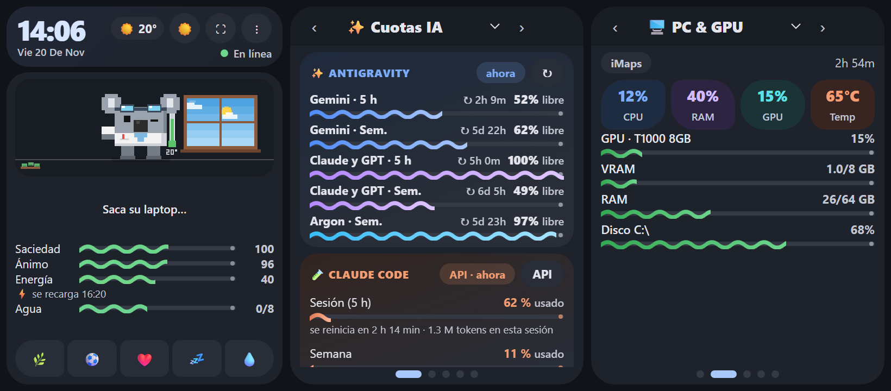
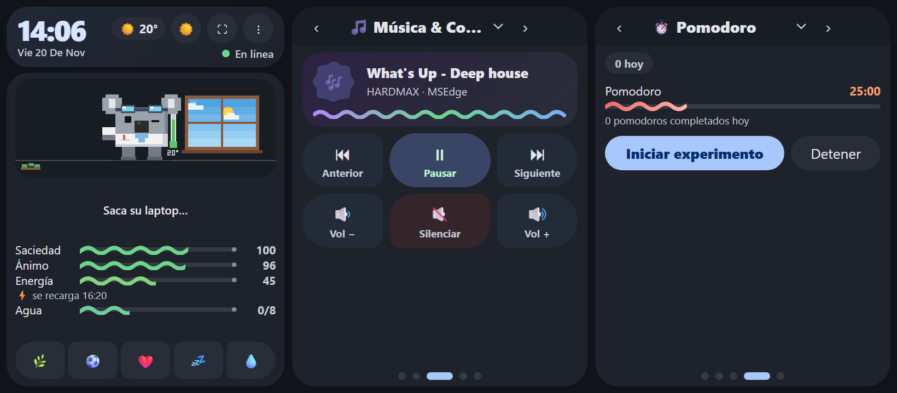

# Koala Desk Monitor 🐨📱

Panel de escritorio independiente para celular Android (diseñado para **Moto G06** en horizontal con estética **Material 3 Expressive**: líneas senoidales animadas, formas orgánicas, grupos de botones conectados y física de resorte), basado en tu **Koala científico**.

| Vista principal (Cuotas IA + PC & GPU) | Música & Control + Pomodoro |
|---|---|
|  |  |

## Qué incluye

- **Koala vivo y autosuficiente:**
  - **Energía y Ánimo ligados a tus cuotas de IA:** mientras más cuota disponible tengas en **Antigravity (Gemini)** y **Claude Code**, el Koala está más contento y activo; si escasean los tokens, su ánimo y energía bajan para avisarte.
  - **Saciedad automática con commits:** cada vez que haces un `git commit` en tus proyectos locales, el Koala come y festeja automáticamente para mantenerse vivo mientras programas.
  - **Reacciona en vivo a Antigravity y Claude Code:** rastrea ambos agentes por separado sin pisarse y te dice exactamente quién está trabajando o quién terminó.
  - Sincronizado con VS Code / Antigravity vía `~/.claude/koala/compartido.json` (sigue funcionando aunque cierres el editor para jugar).
- **Tarjeta unificada `✨ Cuotas IA`:** cuotas restantes y reinicio de **Antigravity** (Gemini 5 h / Semana, Argon, Claude & GPT) en azul/celeste y **Claude Code** (5 h, Semana, ritmo y API directa) en terracota.
- **Monitor de PC & GPU:** CPU, RAM, disco y **NVIDIA GPU** (`nvidia-smi`: uso %, temperatura °C y VRAM).
- **Música & Control Deck:** lee la canción actual en Windows (**GSMTC**: Spotify, YouTube, Chrome, VLC) con forma *Cookie* giratoria, onda senoidal viva, controles multimedia directos y volumen maestro vía **Core Audio (`IAudioEndpointVolume`)**.
- **Notificaciones en vivo (`🔔 Avisos`):** lee las notificaciones del navegador (Edge, Chrome, Firefox, Brave) y de Windows desde `wpndatabase.db` con `node:sqlite`, mostrando avisos emergentes y un historial filtrable.
- **Bloqueo rápido de PC (`🔒`):** botón con doble toque de seguridad junto al reloj para bloquear Windows al instante (`LockWorkStation`).
- **Carruseles deslizables** (hasta 4 paneles configurables), **Reloj**, **Clima**, **Pomodoro**, **Alarmas** y **☀️ Pantalla fija** (compatible incluso en HTTP local).

## Uso rápido

1. Inicia el servidor en tu PC:
   ```powershell
   npm start
   ```
2. En tu **Moto G06** (en la misma red Wi-Fi), abre Chrome y entra a la dirección `Nombre` (por ejemplo `http://iMaps.local:4747`, que no cambia aunque el router renueve la IP) o a `Celular` (`http://192.168.1.X:4747`).
3. Pon el celular en **horizontal**, toca el menú `⋮` de Chrome → **Agregar a pantalla principal** para abrirlo a pantalla completa como app.
4. *(Tip Moto G06)* Activa **Configuración → Batería → Protección contra sobrecarga** (limita la carga al 80 %).

## Inicio automático en Windows (sin ventana negra)

- **Activar inicio automático:** dale doble clic una sola vez a `instalar-inicio-windows.bat`. Crea un acceso directo en la carpeta `Startup` de Windows para que el servidor arranque solo y en segundo plano cada vez que prendas la PC (y lo inicia al momento).
- **Desactivar inicio automático:** dale doble clic a `quitar-inicio-windows.bat`.
- **Iniciar manualmente sin ventana:** doble clic a `iniciar-koala.vbs` (guarda los logs en `koala-desk.log`).
- **Iniciar manualmente con consola visible:** doble clic a `iniciar-koala.bat` (útil para ver la IP local o depurar).

## Activar hooks de trabajo para Antigravity (animación del Koala)

Para que el Koala saque su laptop, teclee mientras Antigravity trabaja y te avise cuando termine un turno largo, ejecuta una sola vez:

```powershell
node scripts/instalar-hooks-antigravity.js
```
*(O dale doble clic a `instalar-hooks-antigravity.bat`).* Registra el hook `koala-monitor` en `~/.gemini/config/hooks.json`.

## Activar cuotas de Antigravity (modelos restantes)

El panel consulta el CLI oficial de Antigravity (`agy -p /usage --output-format json`). Para activarlo en Windows:

```powershell
irm https://antigravity.google/cli/install.ps1 | iex
```

Después abre una terminal nueva, ejecuta `agy` una sola vez para iniciar sesión con tu cuenta de Google, y toca **↻** en la tarjeta de **Cuotas IA**.

> Puedes inspeccionar la respuesta cruda en `http://localhost:4747/api/antigravity/raw`.

## Si el celular no carga la página por Wi-Fi

Permite el puerto `4747` en PowerShell (como administrador):

```powershell
New-NetFirewallRule -DisplayName "Koala Desk Monitor" -Direction Inbound -Protocol TCP -LocalPort 4747 -Action Allow
```

---

## 🎙️ Escucha nuestros podcasts

Si te gustó este proyecto, pásate a escuchar nuestros podcasts sobre ciencia, inteligencia artificial y ciencia ficción:

- **[CiencIA](https://creators.spotify.com/pod/profile/jjas/)** — en Spotify for Creators
- **[CiencIAficción](https://creators.spotify.com/pod/profile/jjas1/)** — en Spotify for Creators
